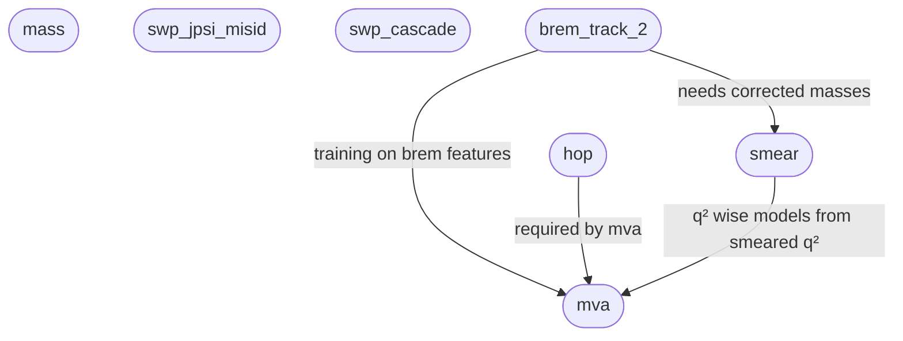

[TOC]

# Description

This documentation explains:

- What workflows are available
- How to run them in a computing cluster
- How to setup a dashboard with [flowo](https://github.com/zhanghaomiao/flowo)

**Note:** In order to run a workflow while another is already running use `--nolock` to bypass the lock mechanism.

# Available workflows

## Friend trees

For this run:

```bash
snakemake -s snakemake/rules/ntuples/friends.smk --configfile snakemake/configs/ntuples/friends.yaml -c 10
```

where the trees are:

- `mass`: The candidates masses are recalculated assuming that the two leptons are pions and kaons. Needed for misID studies.

- `swp_jpsi_misid`: Branches corresponding to lepton kaon swaps that make the resonant mode leak into rare modes. Where the swap is inverted and the $J/\psi$ mass provided

- `swp_cascade`: Branches corresponding to $D\to K\pi$ with $\pi\to\ell$ swaps, where the swap is inverted and the $D$ mass provided.

- `hop`: With the $\alpha$ and mass branches calculated

- `brem_track_2`: This will calculate branches associated to the brem correction. 
    The branches will include:
    - Masses of B and Jpsi.
    - Momenta of mesons and electrons.
    - Derived quantities like `DIRA` or the `brem` categories.

- `mva`: With the BDT branches 
- `smear`: This will calculate the smeared masses `B_Mass_smr` and `Jpsi_Mass_smr` and `q2_smr`.

and they depend on each other as:



The workflow will take care of everything. The user should only have to check the `yaml` config file
and update it.

## Plots

### Cutflow plots

For this run:

```bash
snakemake -s snakemake/rules/plots/cutflow.smk                 \
          --configfile snakemake/configs/plots/cutflow/os.yaml \
          --profile ihep                                       \
          --logger=flowo                                       \
          --logger-flowo-name=plots-cutflow                    \
          --keep-going --quiet                                 \
          --config  kind=cleanup
```

Where

- The `configfile` controls the samples that will be processed.
- `cleanup` refers to the type of cutflow, other kinds are:


| Name | Description |
|---|---|
| `bdt` | Check effect of tightening MVA working point on mass |
| `cleanup` | Check effect of vetos |
| `mass` | Check effect on J/psi mass of tightening the mass cut on the B |
| `ss_shape` | Check SS shape of B and Jpsi mass under charmonium veto |

in `rx_plotter_data/cutflow`.

### Comparison plots

For this run:

```bash
snakemake -s snakemake/rules/plots/compare.smk              \
          --configfile snakemake/configs/plots/compare.yaml \
          --config kind=resolution                          \
          -c 1                                              \
          -n
```

which will make comparison plots between different variables.
The kind can be:

| Name | Description |
|---|---|
| `misid_regions` | Compares different kinds of masses in the PID control region |
| `resolution` | Compares mass under brem correction and emulation |
| `smear` | Compares effect of brem correcting and smearing masses |

### Resonant fits

For the resonant DTF fits run:

```bash
snakemake -s snakemake/rules/fits/dtf-fits-ee.smk \
          --profile ihep                          \
          --logger=flowo                          \
          --logger-flowo-name=reso-dtf-fit        \
          --keep-going                            \
          --quiet                                 \
          --config q2bin=psi2           
```

where the `q2bin` is either `jpsi` or `psi2`. The same workflow exists for the muon 
channel with `dtf-fits-mm.smk` instead. This workflow will:

- Fit MC and use shapes to fit data
- Extract sweights from fits

For the muon channel use `dtf-fits-mm.smk` instead

### Rare fits

To run the fits to the rare mode do:

```bash
snakemake -s           snakemake/rules/fits/rare_fit.smk \
          --configfile snakemake/configs/fits/scan.yaml  \
          --profile    ihep                              \
          --logger=flowo                                 \
          --logger-flowo-name=rare-scan                  \
          --keep-going                                   \
          --quiet
```

where `scan.yaml` runs a fit on a grid of MVA working points. Different configurations can be tried
based on the `yaml` file. The fits will fit the full 2024 dataset together.

## Ntuple transfers


Run:

```bash
snakemake -s snakemake/rules/ntuples/transfer.smk --configfile snakemake/configs/ntuples/transfer.yaml -c 4
```

to run the ntuple tranfer from a remote server. The transfer will run:

- Without password authentication but instead public keys
- To transfer a specific set of files from a specific server.
This is configured both in the `yaml` file and with the first lines
in the `smk` file:

## Minimal datasets

In order to do fits, etc files with a minimal set of entries and branches can be used
in order to speed up the processing. These can be made with:

```bash
snakemake -s snakemake/rules/fits/make_databases.smk \
--profile ihep --logger=flowo                        \
--logger-flowo-name=database                         \
--keep-going                                         \
--configfile snakemake/configs/fits/database.yaml    \
--nolock
```

the settings (datasets to process, branches to store, etc) are found in the `yaml` file.

```python
SERVER = 'ihep'
DATASET= 'brem_track_2'
SSHOPT = '-o StrictHostKeyChecking=no -o BatchMode=yes -o PasswordAuthentication=no -o PubkeyAuthentication=yes'
```

and can be changed

# HTCondor plugin

This should allow snakemake to run workflows through HTCondor jobs. For this follow 
the instructions [here](https://github.com/htcondor/snakemake-executor-plugin-htcondor)

# FLOWO dashboard

Once the instructions below be followed one should be able to do something like:

```bash
snakemake -s snakemake/rules/ntuples/friends.smk \
          --configfile snakemake/configs/ntuples/friends.yaml \
          --profile ihep \                      # Change this to the HTCondor executor you use 
          --logger=flowo \
          --logger-flowo-name=friend-trees \
          --keep-going                          # This will allow next jobs to be submitted even if there are failures
```

Access to a computing cluster, e.g. something to login with `ssh user@lxplus.cern.ch` 

## First-Time Setup (pulling images)

For instructions on how to setup the plugin check [this](https://flowo-docs.pages.dev/quickstart/)
One can also use `podman` insted of docker, in the docker compose step.
A working env file is:

```bash
PORT=3100
DOMAIN=localhost
PROTOCOL=http
SECRET_KEY=12345
TZ=Asia/Shanghai
POSTGRES_DB=flowo_logs
POSTGRES_USER=flowo
POSTGRES_PASSWORD=flowo_password
POSTGRES_HOST=db
FLOWO_WORKING_PATH=/publicfs/ucas/user/campoverde
CONTAINER_MOUNT_PATH=/publicfs/ucas/user/campoverde
BACKEND_CORS_ORIGINS=["http://localhost","http://localhost:3100"]
```

while a typical config file would look like:

```yaml
FLOWO_HOST = "http://localhost:3100"                                                                                                                                            
FLOWO_USER_TOKEN = "This is a key from the flowo dashboard, obtained in settings"                                                                                                            
FLOWO_WORKING_PATH = "/publicfs/ucas/user/campoverde"     
```

which is located in `$HOME/.config/flowo/config.yaml`

## Connecting from Your Laptop

Open an SSH tunnel:

```bash
ssh -L 3100:localhost:3100 campoverde@lxlogin002.ihep.ac.cn
```

Then open your browser at `http://localhost:3100`.

## Making the config file in the server

Generate a token in the browser and then use it with:

```bash
cat > ~/.config/flowo/config.toml << EOF
FLOWO_HOST = "http://localhost:3100"
FLOWO_USER_TOKEN = "flw_GlYaCLMz1flA_x8N90w5DOmg1a-gRQ9I6zfR3oO2Tas"
FLOWO_WORKING_PATH = "/publicfs/ucas/user/campoverde"
EOF
```

in the server (e.g. lxplus)

