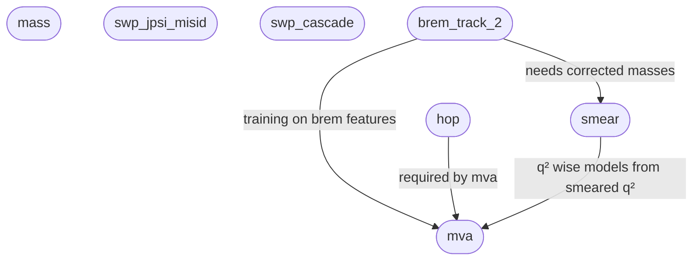

[TOC]


> [!WARNING]
> For the instructions below to work, you need to use the `root` and `xrootd`
> versions from conda, due to [this](https://github.com/root-project/root/issues/20782) issue:
> i.e.
> ```bash
> pip uninstall root
> pip uninstall xrootd
> micromamba install root xrootd
> ```

This project is meant to:

- Download ntuples for a given AP
- Reorganize them into a directory structure
- Provide tools to access the data
- Provide tools to correct the data and add extra information

All the instructions below assume that there is a directory where the data will go.
The location of that directory needs to be exported as in:

```bash
export ANADIR=/home/user/rk
```

ideally in the `~/.bashrc` file. The user should have around 1TB of storage in the location where `ANADIR` lives.

## Downloading ntuples

For this:

- Setup the LHCb environment with:

```bash
. /cvmfs/lhcb.cern.ch/lib/LbEnv
```

- Create a grid proxy with `lhcb-proxy-init`
- Log into APD with `apd-login`

do:

```bash
rxdata download-ntuples -n 6 -v v1r5849
```

where the downloaded ntuples will come from version `v1r5849` and they will be
downloaded with 6 cores from the `rx_filter` project.

## Transferring ntuples from server

If the ntuples were downloaded to a local cluster and the user needs them in
their laptop one can use the following snakemake workflow:

```bash
snakemake -s snakemake/rules/ntuples/transfer.smk  --configfile snakemake/configs/ntuples/transfer.yaml -c 8
```

Which requires:

- `ANADIR` to also be defined in the laptop's environment
- The remote filesystem to be mounted through SSHFS
- The fields:
```
SERVER = 'ihep'
DATASET= 'from_ap'
```
in the `smk` file to be updated accordingly
- The `yaml` file to also be updated.

## Organizing the ntuples into a directory structure

The ntuples downloaded above will end up in the `downloads/` directory
and will contain files with a structure like:

```bash
rootls -r 00383232_00000001_1.sim10g_ss.root
FileSummaryRecord
Hlt2RD_B0ToKpPimEE_SameSign_MVA
  DecayTree
Hlt2RD_BuToKpEE_SameSign_MVA
  DecayTree
MCDT
  MCDecayTree
MCDT_HEADONLY
  MCDecayTree
```

But the files need to be:

- Merged by job if they are still split, i.e. one file per job.
- Split by project, i.e. placed in an `rk` and `rkst` 
  project with the corresponding trees properly located
- Renamed such that they follow the naming convention the code understands

For this do:

```bash
rxdata organize-paths -v v1r5849
```

which will produce files that will look like:

```bash
MCDecayTree  # True information
DecayTree    # Reco information for a given trigger
```

> [!NOTE]
> The merging step will require writting large temporary files. 
> These will live in `/tmp/`. This can be overriden with:
> 
> ```bash
> export SCRATCH=/some/large/storage/device/
> ```
> In case `/tmp` has storage left. 

## Checking for corrupted files

For this run:

```bash
check_corrupted -p /path/to/directory/with/files -x "data_*_MVA_*.root"
```

Which will check for corrupted files and will remove them.
`-x` can be used to pass wildcards, in the case above, it would target only data.
After removal, the download can be tried again, which would run only on the missing samples.
This might allow for these files to be fixed, assuming that they were broken due to network issues. 

## Samples naming

The samples were named after the DecFiles names for the samples and:

- Replacing certain special charactes as shown [here](https://github.com/acampove/ap_utilities/blob/main/src/ap_utilities/decays/utilities.py#L24)
- Adding a `_SS` suffix for split sim samples. I.e. samples where the photon converts into an electron pair.

A useful guide showing the correspondence between event type and name is [here](https://github.com/acampove/ap_utilities/blob/main/src/ap_utilities_data/evt_form.yaml)

## Printing information on samples

Use:

```bash
check_sample_stats -p /path/to/rx_samples.yaml
```

to print a table to markdown with the sizes of each sample in Megabytes. e.g.:

```markdown
| Sample                                      | Trigger                        |   Size |
|:--------------------------------------------|:-------------------------------|-------:|
| Bu_JpsiK_mm_eq_DPC                          | Hlt2RD_BuToKpMuMu_MVA          |  15829 |
| Bs_Jpsiphi_mm_eq_CPV_update2016_DPC         | Hlt2RD_BuToKpMuMu_MVA          |  11164 |
| Bd_JpsiKst_mm_eq_DPC                        | Hlt2RD_BuToKpMuMu_MVA          |   9945 |
| Bu_JpsiK_ee_eq_DPC                          | Hlt2RD_BuToKpEE_MVA_cal        |   8873 |
| Bu_JpsiK_ee_eq_DPC                          | Hlt2RD_BuToKpEE_MVA            |   8488 |
...
```

## Copying files

If the original files are downloaded to a cluster and the user needs the files in e.g. a laptop one could:

- Use SSHFS to mount the cluster's file system in the laptop.
- Copy the files through `copy_samples`

### Usage

```bash
copy_samples -k all -p rk -s main -n 5 -S local
```

where:

`-k` Kind of files to be copied, i.e. friend tree like `mva`, `main`, `hop` etc. For everything use `all`.   
`-c` Name of config specifying what to copy, e.g. `rk`, `rkst`. This is also the project directory.
`-s` Optional, name of friend tree to skip, e.g. `mva`
`-v` Version of files to download. By default it should get the latest. This should be used only if `k` is not `all`
     given that different types of friend trees will have different versions.
`-S` Server name. This is where the files will be copied to, can be `local`, `lxplus` or `lxlogin`. I.e. transfer files from
cluster to laptop, to EOS or to IHEP cluster.

### Servers

The files can be copied to either a local computer or to EOS

#### EOS 

For this one has to setup a control master socket with:

```bash
ssh -fN -o ControlMaster=auto -o ControlPath=/tmp/cm-%r@%h:%p -o ControlPersist=100m $USER@lxplus.cern.ch
```

which will allow the same connection to be used by the transfer and won't prompt for passwords

#### Local

I.e. to a laptop. For this one needs a _reverse forwarding_ SSH connection to IHEP. I.e.

```bash
ssh -R 2223:localhost:2223 $USER@lxlogin004.ihep.ac.cn
```

which will listen in port 2223 in both the laptop and the cluster. 
Additionally:

- The public key in the laptop needs to be authorized in the cluster.
- One nees to make sure the laptop is running the SSH daemon and the config specifies port `2223`, i.e.

```bash
# Open and
# add Port 2223
sudo vim /etc/ssh/sshd_config

# Needed in SELinux
sudo semanage port -a -t ssh_port_t -p tcp 2223
sudo systemctl restart sshd
```

Then in the cluster the code will try to transfer the files through `localhost` port 2223.

### Configs

The config files live in `src/rx_data_data/copy_files` and can be adapted for new samples or different source paths.
If the files to be copied already exist locally, it will check that the sizes are the same, if not, it will remove the
local file and copy again.


## Calculating extra branches

Given the files produced by `post_ap`, new branches can be attached. These branches can be calculated using
`branch_calculator` and can be placed in small files. These latter files would be made into friends of the main files.

### Create ntuple statistics databases

In order to do this we assume that all the ntuples live in `$ANADIR/Data/rkst/main/vx`, where `ANADIR` needs to be exported
such that the code will pick it up. `vx` represents a version of the ntuples (e.g. `v1`, `v2`, etc). Then run:

```bash
rxdata store-sample-db -v v1 -p rk
rxdata store-sample-db -v v1 -p rkst
```

`v1` is the version of the main trees. This will create a database in `$ANADIR/DB/statistics`. This database will contain all the names of the files
used in the analysis as well as the number of entries. This is needed in order for the code to know how to split the
files to load balance effectively the processing of the ntuples.

### Calculate branches

```bash
branch_calculator -g v0 -k mva -p rkst -M v1 -F v5 -i 449 -e 100000
```

which will:

- Split the input files, from the main tree category into batches, use batch `449`.
- Each batch is meant to have round `100000` events.
- Create a new set of files in `$ANADIR/Data/mva/v5` with each input file, corresponding to an output file of version `v1`.

Currently the command can add:

- `mass`: The candidates masses are recalculated assuming that the two leptons are pions and kaons. Needed for misID studies.

- `swp_jpsi_misid`: Branches corresponding to lepton kaon swaps that make the resonant mode leak into rare modes. Where the swap is inverted and the $J/\psi$ mass provided

- `swp_cascade`: Branches corresponding to $D\to K\pi$ with $\pi\to\ell$ swaps, where the swap is inverted and the $D$ mass provided.

- `hop`: With the $\alpha$ and mass branches calculated

- `brem_track_2`: This will calculate branches associated to the brem correction. 
    The branches will include:
    - Masses of B and Jpsi.
    - Momenta of mesons and electrons.
    - Derived quantities like `DIRA` or the `brem` categories.

- `mva`: With the BDT branches 
- `smear`: This will calculate the smeared masses `B_Mass_smr` and `Jpsi_Mass_smr` and `q2_smr`.



However this whole thing should be done with snakemake workflows, so that all these steps are properly
chained and automated as described [here](doc/workflows.md)

## Missing files

Once the extra branches have been calculated, one will have a file structure like:

```
├── brem_track_2
│   └── v1
├── hop
│   ├── v1
│   └── v2
├── main
│   ├── v1
│   ├── v5
│   └── v7
├── mva
│   ├── v1
│   ├── v2
│   ├── v3
│   └── v4
├── swp_cascade
│   ├── v1
│   └── v2
└── swp_jpsi_misid
    ├── v1
    └── v2
```

Typically (not always), a sample in `main` should be also in all the other friend trees.
If samples are missing, one could do:

```bash
check_missing -p rx
```

other options are:

```
options:
  -h, --help            show this help message and exit
  -p --project E.g. rx 
  -o --only    Optional, if used, will check only this friend, e.g. mva
  -s SKIP_SAM [SKIP_SAM ...], --skip_sam SKIP_SAM [SKIP_SAM ...]
                        Samples to skip
  -l {10,20,30}, --log_level {10,20,30}
                        Logging level
```

the output will be `missing.yaml`. This file will tell you:

- Which friend trees have which samples missing.
- Which are the files missing

In this case `missing` is relative to the samples and files in the `main` sample.

## Moving files from one project to another

If one needs to create a new project from an existing one, and put existing files
in that project, one can:

```bash
move_sample -r "^data_24.*" -s rk -t rk_old
```

which will create an `rk_old` project with both main and friend trees of the `rk`
project and will move all data files to it. Use `-d` for a dry run.

## Calculating luminosity

For this one would have to use the `get_lumi` script in this project, together
with the one in [this](https://gitlab.cern.ch/lhcb-luminosity/lumi_calib/-/blob/master/get_lumi.py?ref_type=heads)
project. This should, at some point, be cleaned up.

